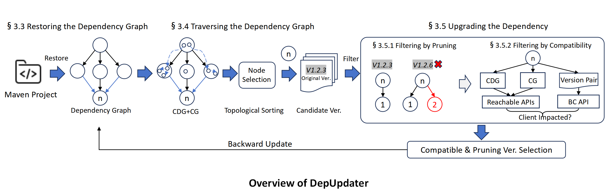

# DepUpdater

**Compatibility-aware dependency upgrades for Java projects.**

[](https://doi.org/10.1145/3744916.3773233)
[](https://arxiv.org/abs/2511.06762)

Read the [paper](https://doi.org/10.1145/3744916.3773233) or visit the
[project website](https://marklee131.github.io/DepUpdater/).
The [database snapshots](https://zenodo.org/records/20340636) and
[BibTeX citation](assets/depupdater.bib) are also available.

DepUpdater analyzes a Maven project's dependency graph to select upgrades that
reduce technical lag while considering breaking API changes and redundant
dependencies. It combines dependency pruning with client-impact analysis, then
validates the resulting project with Maven builds and tests.

<details>
<summary>Contents</summary>

- [Choose a version](#choose-a-version)
- [Setup and usage](#usage)
- [Understand the results](#understand-the-results)
- [Research data](#data-for-rqs)
- [Development](#development)
- [Citation](#citation)

</details>

## Choose a version

| Your goal | Starting point |
| --- | --- |
| Reproduce the ICSE 2026 experiments | [Original artifact at `163cf41`](https://github.com/MarkLee131/DepUpdater/tree/163cf411da6047dbacb8340602314723d88b729b), with its [setup instructions](https://github.com/MarkLee131/DepUpdater/blob/163cf411da6047dbacb8340602314723d88b729b/README.md#usage), snapshots, and experiment configuration. |
| Use the current version | [`main`](https://github.com/MarkLee131/DepUpdater/tree/main), documented below. |

`main` is the default branch for ongoing development and the project website.
The original `artifact` branch is preserved. Corrected analyzer failures and
version ordering can change recommendations and technical-lag counts on
`main`. `--version-order legacy` is a comparison option, **not a
complete reproduction of the published artifact**.

## How it works

1. **Restore** the Maven dependency graph, including transitive dependencies.
2. **Traverse** the graph using dependency relationships to order the analysis.
3. **Filter** candidate versions by pruning and client-compatibility requirements.
4. **Update and validate** the selected dependencies with Maven builds and tests.

<details>
<summary>View the workflow from the paper</summary>



</details>

## Usage

### Requirements

| Component | Setup |
| --- | --- |
| Java | JDK 17; `java` must be on `PATH`. |
| Maven | Maven 3.9.5, as documented for the artifact; `mvn` must be on `PATH`. |
| Python | Python 3.10 (artifact: 3.10.12) and the pinned [requirements](requirements.txt). The offline reliability tests have also been run with Python 3.11. |
| Git and shell | Git on `PATH` and a POSIX shell for the commands below and the Revapi launcher. |
| Databases | MongoDB on `localhost:27017`, plus `reusable_data.sqlite`. The supplied MongoDB setup uses Docker with Compose. |

The target project must contain a root `pom.xml` and a `pom.xml` in the selected
module. Its dependencies must be resolvable with your Maven configuration.
Bundled Java analyzers are in [`tools/analyzers/`](tools/analyzers/).

### 1. Install the tool

```sh
git clone --branch main https://github.com/MarkLee131/DepUpdater.git
cd DepUpdater
python3 -m venv .venv
source .venv/bin/activate
python -m pip install -r requirements.txt
```

### 2. Prepare the databases

Download the three archives from the [Zenodo record](https://zenodo.org/records/20340636):
`maven.zip`, `maven_deps.zip`, and `reusable_data.zip`.

Follow the [database setup guide](docs/setup.md) to place the extracted files,
restore the MongoDB collections, create indexes, and check connectivity.
**All three snapshots are required before running an analysis.** Installing the
Python packages alone is not sufficient.

### 3. Analyze a project

Run from the DepUpdater directory, with the virtual environment activated:

```sh
python -m depupdater \
  --root /path/to/project \
  --module module-a \
  --output /path/to/new-run
```

Replace the example paths with your project and a **new output directory outside
the input project**. Use `--module .` to analyze the root module. The CLI analyzes
an independent copy of the current working tree, including uncommitted and
untracked files, and retains that copy for inspection.

For example, for a local checkout of [mall](https://github.com/macrozheng/mall):

```sh
python -m depupdater --root /path/to/mall --module mall-common
```

Without `--output`, the CLI creates and prints a temporary run directory and
keeps it after the run.

### CLI options

Use `python -m depupdater --help` for the executable reference. Existing
`python MainProcess.py ...` commands remain supported through a thin launcher.

| Option | Meaning and default |
| --- | --- |
| `-r`, `--root` | **Required.** Path to the target project's working tree. |
| `-m`, `--module` | **Required.** Module path relative to the root; `.` selects the root module. |
| `-j`, `--jar` | Optional client JAR path, relative to the root. |
| `-l`, `--local_dep_jar` | Optional local dependency JAR paths, relative to the root; accepts multiple paths. |
| `--output` | New run directory outside the input project; defaults to a retained temporary directory. |
| `--workers` | Positive worker limit; defaults to `min(4, CPU count)`, capped by task count. Use `1` for serial execution. |
| `--analyzer-timeout` | Positive, finite timeout per Revapi/Soot/BCEL invocation; defaults to `300` seconds. This is not a whole-run or Maven-build timeout. |
| `--version-order` | `maven` (default) or `legacy` (comparison only). |

## Understand the results

```text
new-run/
├── run.json                  # status, exit code, paths, and analysis settings
├── error.txt                 # traceback when an exception is captured
├── workspace/<project>/      # working copy, build outputs, and candidate POM
└── analysis/                 # dependency graphs, logs, and lag.csv when produced
```

Check `run.json` and the build/test output first. After traversal, the selected
module's `_original_pom.xml` holds the original POM and `_backed_up_pom.xml` holds
the candidate; the workspace's `pom.xml` is restored. The input project's POM
stays unchanged. A failed or early-exit run may have incomplete or absent
candidate files—review the run status before using them.

Reported metrics include compilation/test outcomes, original and current
technical lag, and original and current dependency counts. Technical lag counts
positions in the filtered candidate-version list; it is not elapsed release time.
See [version-ordering details](docs/reliability.md#version-ordering-and-technical-lag)
when comparing runs.

| Exit code | Meaning |
| --- | --- |
| `0` | Successful run, including an already up-to-date module. |
| `1` | Analysis, build, test, or other execution failure. |
| `2` | Invalid CLI arguments. |
| `130` | Interrupted run. |

<a id="reliability-branch"></a>

## Reliability improvements

The `main` branch includes independent working copies, checked analyzer exits
and timeouts, a separate verified-analysis cache, scoped POM edits, deterministic
Maven version ordering, bounded workers, and more robust database/JAR handling.

Read the [reliability notes](docs/reliability.md) for isolation limits, cache
behavior, resource controls, failure semantics, and differences from the artifact.
For setup failures, start with [troubleshooting](docs/setup.md#troubleshooting).

## Data for RQs

| Research question | Data |
| --- | --- |
| **RQ1 — Tool comparison** | [DepUpdater, Dependabot, and Snyk results](research/results/rq1/) |
| **RQ2 — Ablation study** | [Compatibility-only, pruning-only, and naive variants](research/results/rq2/) |
| **RQ3 — Transitive upgrade impact** | [Client-impacting API and broken-client distributions](research/results/rq3/) |

<a id="for-major-revision"></a>
<a id="pull-requests-to-upgrade-dependencies"></a>

[Supplementary research notes](docs/research-results.md) preserve the project-level
results, N/A interpretation, and upstream upgrade PRs reported by the artifact.
These are study records, not live PR status or repository popularity metrics.

## Development

With the Python dependencies and a JDK installed:

```sh
python -m unittest discover -s tests -v
```

The offline suite covers workspace preservation, analyzer failures/timeouts,
POM handling, Maven ordering, multiprocessing, database transactions, and JAR
download integrity. It requires neither a running MongoDB instance nor downloaded
snapshots, and does not replace the published experiment reproduction.

| Path | Purpose |
| --- | --- |
| [`depupdater/`](depupdater/) | Python package: CLI, analysis, graph updates, preprocessing, storage, and metrics. |
| [`MainProcess.py`](MainProcess.py) | Compatibility launcher for existing commands. |
| [`tools/analyzers/`](tools/analyzers/), [`tools/java/`](tools/java/) | Bundled analyzer distributions and the Maven version-ordering helper. |
| [`tests/`](tests/) | Offline regression tests. |
| [`research/`](research/) | Published result CSVs and historical baseline scripts. |
| [`docs/`](docs/) | Setup, reliability, research, architecture, and website guides. |
| [`index.html`](index.html), [`assets/`](assets/), [`_data/`](_data/) | GitHub Pages structure, static assets, and author metadata. |

See the [repository layout and migration guide](docs/architecture.md) for module
names and resource locations.

For bug reports, include the command, tool commit, Java/Maven/Python versions,
exit code, and relevant logs from the run directory. Open an
[issue](https://github.com/MarkLee131/DepUpdater/issues) or submit a pull request.

## Citation

Rui Lu, Lyuye Zhang, Kaixuan Li, Min Zhang, and Yixiang Chen.
**Minimizing Breaking Changes and Redundancy in Mitigating Technical Lag for Java Projects.**
*ICSE 2026*, pp. 2237–2249. [DOI: 10.1145/3744916.3773233](https://doi.org/10.1145/3744916.3773233).

Use the [BibTeX citation](assets/depupdater.bib) or read the
[open-access preprint](https://arxiv.org/abs/2511.06762).
